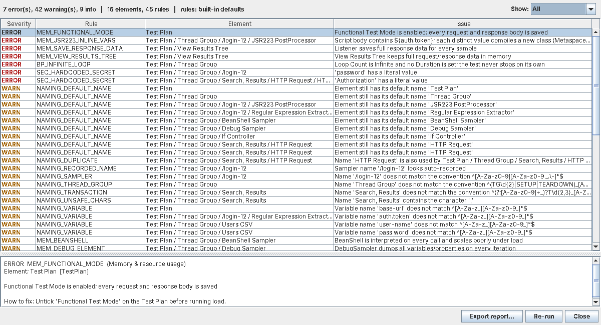

# JMX Lint: a script reviewer for Apache JMeter

[](https://github.com/jagsrj/jmeter-script-linter/actions/workflows/build.yml)

JMX Lint reviews JMeter test plans (`.jmx`) before they are run or merged. It catches:

1. **Naming convention violations**: thread groups, transactions, samplers, variables, default and recorded names, duplicates, report-breaking characters.
2. **Memory-leak and resource risks**: the patterns that grow the load generator's heap or Metaspace, or leak threads and file handles during a long test (`${var}` inside Groovy, uncached scripts, View Results Tree, response data saved to results, threads and unclosed streams in scripts ...).
3. **Industry best practices**: infinite loops without a duration, no ramp-up, no think time, no assertions, hard-coded hosts, uncorrelated session tokens, missing cookie manager or timeouts, hard-coded passwords, and more.

It ships as **one jar** that works two ways:

| Mode | How | Use it for |
|---|---|---|
| **JMeter plugin** | Drop the jar in `JMETER_HOME/lib/ext`, then **Tools > Lint Test Plan (JMX Lint)** | Script authors reviewing as they work |
| **CLI** | `java -jar jmx-lint.jar scripts/` | CI quality gates, pre-commit hooks, bulk reviews |



## Quick start

```bash
# build (needs JDK 11+; no internet needed)
./build.sh                       # -> target/jmx-lint-1.0.0.jar
# or with Maven
mvn verify

# install as a JMeter plugin (JMeter 5.x)
cp target/jmx-lint-1.0.0.jar $JMETER_HOME/lib/ext/
# restart JMeter, open a plan, then Tools > Lint Test Plan (JMX Lint)

# or run from the command line
java -jar target/jmx-lint-1.0.0.jar my-plan.jmx
java -jar target/jmx-lint-1.0.0.jar --rules jmx-lint.properties --format junit -o lint.xml scripts/
```

Exit codes: `0` clean, `1` findings at or above `--fail-on` (default `ERROR`), `2` usage or config error.

| Option | |
|---|---|
| `-r, --rules <file>` | Team rules file. Overrides the built-in defaults. |
| `-f, --format` | `text` (default), `json`, `junit` (CI test report), `markdown` (PR comment or job summary) |
| `-o, --output <file>` | Write the report to a file |
| `--fail-on` | `ERROR`, `WARN`, `INFO` or `NONE` |
| `--list-rules` | Print all rules with their effective severity |
| `--print-default-config` | Print the full default rules file. Start your team file from it. |

## Rules live in a param file, and that's the recommended setup

Naming conventions differ from team to team, so **all rules are data, not code**. The defaults are bundled
in the jar ([`jmx-lint-default.properties`](src/main/resources/io/github/jagsrj/jmxlint/jmx-lint-default.properties)).
A team file only lists what it changes:

```properties
# jmx-lint.properties, committed next to your .jmx scripts
global.failOn=WARN
NAMING_TRANSACTION.pattern=^T\\d{2}_[A-Z][A-Za-z0-9_]*$
NAMING_SAMPLER.pattern=^\\d{2}_(GET|POST|PUT|PATCH|DELETE)_[A-Za-z0-9_]+$
NAMING_VARIABLE.pattern=^[a-z][a-zA-Z0-9]*$
BP_SAMPLER_OUTSIDE_TRANSACTION.severity=WARN
MEM_EMBEDDED_NO_CACHE.enabled=false
```

Every rule supports `RULE_ID.enabled`, `RULE_ID.severity` (`ERROR|WARN|INFO`) and rule-specific parameters.
Because it's a `.properties` file, **double every backslash in a regex** (`\d` becomes `\\d`). An empty pattern turns that
check off. See [`examples/jmx-lint.properties`](examples/jmx-lint.properties).

Why a file and not hard-coded rules: one jar serves every team and project. The conventions are versioned and
reviewed in git together with the scripts. The GUI and CI apply the same rules, and changing a convention needs no rebuild.

**Rules file lookup**

| | CLI | JMeter GUI |
|---|---|---|
| 1 | `--rules <file>` | JMeter property `jmxlint.rules` (e.g. in `user.properties`) |
| 2 | `-Djmxlint.rules=<file>` | `jmx-lint.properties` in the same folder as the open `.jmx` |
| 3 | `./jmx-lint.properties` | `JMETER_HOME/bin/jmx-lint.properties` |
| 4 | built-in defaults | built-in defaults |

**Suppressing a finding on purpose:** put `lint-ignore: RULE_ID[, RULE_ID]` (or `lint-ignore: ALL`) in that
element's *Comments* field in JMeter, ideally with the reason or ticket number.

## Default conventions (all configurable)

| Element | Default convention | Example |
|---|---|---|
| Thread Group | `TGnn_Flow`, `SETUP_x`, `TEARDOWN_x` | `TG01_AccountOpening` |
| Transaction Controller | `Tnn_Action` (optional script prefix) | `T01_LaunchHomePage`, `ACC_T01_Launch` |
| Sampler | starts alphanumeric, letters/digits/`_ - .`/space only; not recorded (`/path`, `-12`) or default names | `01_GET_HomePage` |
| Variables (extractors, CSV, UDV) | `^[A-Za-z_][A-Za-z0-9_]*$` (no `-`, `.` or spaces) | `authToken`, `USER_ID` |
| All | no default names ("HTTP Request"), unique sampler and transaction names, no `, " ; < > |` or tabs, max length | |

## Rule summary (45 rules)

| Category | Rules |
|---|---|
| **Naming** (9) | `NAMING_TEST_PLAN`, `NAMING_THREAD_GROUP`, `NAMING_TRANSACTION`, `NAMING_SAMPLER`, `NAMING_DEFAULT_NAME`, `NAMING_RECORDED_NAME`, `NAMING_VARIABLE`, `NAMING_DUPLICATE`, `NAMING_UNSAFE_CHARS` |
| **Memory and resources** (15) | `MEM_FUNCTIONAL_MODE`, `MEM_VIEW_RESULTS_TREE`, `MEM_GUI_LISTENER`, `MEM_SAVE_RESPONSE_DATA`, `MEM_RESULT_SAVER`, `MEM_DEBUG_ELEMENT`, `MEM_BEANSHELL`, `MEM_JSR223_LANGUAGE`, `MEM_JSR223_NO_CACHE`, `MEM_JSR223_INLINE_VARS`, `MEM_SCRIPT_THREADS`, `MEM_SCRIPT_UNCLOSED_RESOURCE`, `MEM_SCRIPT_GROWING_STATE`, `MEM_EMBEDDED_NO_CACHE`, `MEM_EXTRACT_ALL_MATCHES` |
| **Best practice** (20) | `BP_INFINITE_LOOP`, `BP_RAMP_UP`, `BP_PARAMETERIZE_LOAD`, `BP_THINK_TIME`, `BP_EMPTY_CONTAINER`, `BP_MISSING_ASSERTION`, `BP_TRANSACTION_INCLUDE_TIMERS`, `BP_SAMPLER_OUTSIDE_TRANSACTION`, `BP_EXTRACTOR_DEFAULT`, `BP_IF_CONTROLLER_EXPRESSION`, `BP_CSV_ABSOLUTE_PATH`, `BP_DISABLED_ELEMENTS`, `BP_TEST_PLAN_DESCRIPTION`, `BP_HARDCODED_HOST`, `BP_HTTP_DEFAULTS`, `BP_COOKIE_MANAGER`, `BP_HTTP_TIMEOUTS`, `BP_KEEPALIVE`, `BP_HTTP_IMPLEMENTATION`, `BP_UNCORRELATED_VALUE` |
| **Security** (1) | `SEC_HARDCODED_SECRET` (literal passwords, API keys, `Authorization` headers, credentials in raw bodies) |

Full descriptions, default severities and the explanation of each memory rule are in **[docs/RULES.md](docs/RULES.md)**.
See [docs/sample-report.md](docs/sample-report.md) for the report on [`examples/bad-plan.jmx`](examples/bad-plan.jmx).

## CI quality gate

GitHub Actions:

```yaml
- name: Lint JMeter scripts
  run: |
    curl -sSLo jmx-lint.jar https://github.com/jagsrj/jmeter-script-linter/releases/download/v1.0.0/jmx-lint-1.0.0.jar
    java -jar jmx-lint.jar --rules perf/jmx-lint.properties -f markdown perf/scripts >> "$GITHUB_STEP_SUMMARY"
```

Jenkins: run with `-f junit -o jmx-lint.xml`, then `junit 'jmx-lint.xml'`. Each finding shows up as a failed
test (ERROR and WARN) or a skipped test (INFO).

## Memory safety of the plugin itself

The linter runs inside a long-lived JMeter GUI, so it's written not to leak:

- The `.jmx` is parsed into a small string-only model, and the XML DOM is discarded right after parsing. Nothing is cached between runs.
- No static references to JMeter GUI objects. JMeter APIs are reached through short-lived reflective calls (`JMeterBridge`).
- The results window is non-modal and `DISPOSE_ON_CLOSE`, and linting runs on a `SwingWorker`, off the UI thread.
- Every stream and directory walk uses try-with-resources.
- The XML parser is hardened against XXE and entity-expansion attacks (no DOCTYPE, no external entities).
- The self tests include a leak test that lints a plan 3,000 times and asserts the heap stays flat after GC.

## Project layout

```
src/main/java/io/github/jagsrj/jmxlint/
  model/    JmxParser (secure), JmxElement, TestPlanModel (JMeter scoping rules), ElementTypes
  config/   LintConfig: param file loading and overlay
  core/     LintEngine, Rule, RuleContext (suppression), Finding, Severity
  rules/    NamingRules, MemoryRules, BestPracticeRules, RuleRegistry
  report/   text / json / junit / markdown
  cli/      JmxLintCli
  gui/      LintMenuCreator (Tools menu), LintResultDialog, JMeterBridge
src/stubs/  compile-only copy of JMeter's MenuCreator interface for the offline build (never packaged)
src/test/   SelfTest + fixture plans (good, bad, edge cases)
```

**Adding a rule:** add a `SimpleRule` in the matching `*Rules` class, add its `enabled`/`severity` keys to the
default properties file, and add a fixture element that triggers it. `SelfTest` fails if any rule is never
triggered or is missing from the defaults file.

Requirements: JMeter 5.x with Java 8 or newer at runtime. Building with `build.sh` needs JDK 11 or newer.

## License

MIT
